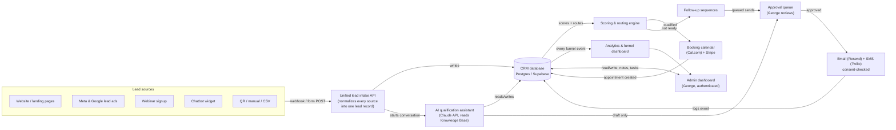
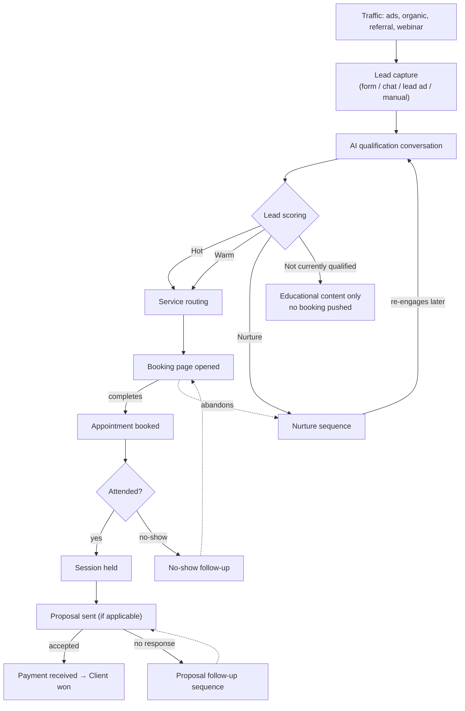
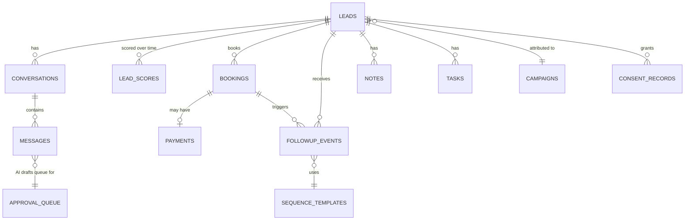

# Phase 1 — Architecture & Discovery Plan

**Project:** GN Innovates AI Lead Generation, Qualification, Booking & Follow-Up System
**Prepared for:** George Nabil, GN Innovates
**Status:** Draft — awaiting approval. No paid integrations, live messaging, or
production code have been implemented.

> Nothing in this document is a claim about GN Innovates' actual prices, policies,
> testimonials, or credentials. Every business fact below is a placeholder or a
> question — it must be confirmed or supplied by George before it appears anywhere
> a lead can see it.

---

## 1. Executive summary

This is a plan, not a build. It proposes an architecture for a system that:

1. Captures leads from every channel GN Innovates uses (site, landing pages,
   webinars, Meta/Google lead ads, chatbot, QR, manual, CSV).
2. Runs a one-question-at-a-time AI intake conversation that identifies the lead's
   business situation and problem — never pressuring, never promising results,
   always identifying itself as the GN Innovates AI assistant.
3. Scores the lead transparently (Hot / Warm / Nurture / Not currently qualified /
   Existing client) with a stored reason, editable by George.
4. Routes the lead to the correct next step (strategy session, mentorship call,
   local SEO assessment, ad consultation, webinar, nurture, or manual review) —
   without ever showing a price that hasn't been approved in admin settings.
5. Books qualified leads onto the right calendar, collects payment when required,
   and confirms/reminds/handles no-shows.
6. Follows up automatically in English or Egyptian Arabic (lead's choice), gated by
   consent, with every AI-drafted or bulk message queued for George's approval
   before it sends.
7. Gives George one dashboard for leads, bookings, conversations, follow-ups,
   proposals, payments, and funnel/revenue analytics.

Everything below is a recommendation for George to accept, change, or reject.
**No API keys will be created and no paid plan will be purchased until George
approves the architecture in Section 12.**

---

## 2. Recommended system architecture

Eight layers, one codebase where possible, so there is one thing to maintain:

- **Capture layer** — every entry point (site forms, landing pages, webinar
  registration, Meta/Instagram lead ads, Google Ads lead forms, chatbot widget, QR
  → landing page, manual entry, CSV import) writes into one **unified lead intake**
  endpoint, so nothing downstream needs to know which channel a lead came from.
- **Core application** (custom-built) — the CRM data, the admin dashboard, the
  scoring engine, the routing engine, and the knowledge base George edits.
- **AI layer** — Claude API runs the qualification conversation and drafts
  follow-up copy. It only answers from the knowledge base; it never sends a
  message on its own — drafts land in George's approval queue.
- **Booking & payments layer** — calendar tool + Stripe, feeding straight back into
  the CRM as a booking record.
- **Communication layer** — email + SMS providers, triggered only by app logic,
  gated by stored consent and (for AI-written or bulk sends) George's approval.
- **Analytics layer** — every funnel step is logged as an event; the dashboard
  aggregates it by source, campaign, service, and language.
- **Admin/auth layer** — George's login, role-based access, audit log.

**Why this shape:** one intake endpoint means adding a new lead source later (say,
a new landing page or a WhatsApp channel) is a config change, not a rebuild. The AI
never has direct send authority — every automated or AI-written message passes
through the approval queue, which is the mechanism that satisfies "require
approval before sending a customized AI-written sales message."

---

## 3. Funnel

The dotted arrows are re-entry points: an abandoned booking, a no-show, or a
stalled proposal all loop back into follow-up rather than dead-ending. This loop is
the difference between a form-and-forget site and the "follow up until they book
or decline" system requested.

---

## 4. Recommended technology stack

Optimized for **low monthly cost, one maintainable codebase, and a solo operator**
(George as the only admin). This is a recommendation, not a commitment — Section 5
lays out the alternatives.

| Component | Recommendation | Why |
|---|---|---|
| Application (web + admin + APIs) | **Next.js** (React), one codebase | Forms, chatbot widget, booking pages, and the admin dashboard all live in one deployable app — one thing to maintain, one bill. |
| Hosting | **Vercel** | Built for Next.js, scales to zero, generous free tier, simple deploys from GitHub. |
| Database | **Supabase** (managed Postgres) | Real relational DB (needed for leads/scores/bookings/payments relationships), plus built-in auth, row-level security, and backups — free tier covers early volume. |
| Conversational AI | **Anthropic Claude API** | Qualification conversation, lead-scoring reasoning, and drafting follow-up copy — answers constrained to the knowledge base per the "must answer only from approved information" requirement. |
| Transactional email | **Resend** | Simple API, generous free tier, good deliverability, straightforward domain verification (SPF/DKIM/DMARC). |
| SMS | **Twilio** | Industry standard, pay-as-you-go, handles US A2P 10DLC registration (required for US business SMS) directly. |
| Calendar & booking | **Cal.com** | Open-source, can self-host for $0 or use the hosted plan; supports paid-booking flows, buffers, reminders, reschedule/cancel — fits "display call type, collect payment, confirm, remind" directly. |
| Payments | **Stripe** | Standard for paid sessions/deposits; no monthly fee, per-transaction pricing. |
| Spam/bot protection | **Cloudflare Turnstile** | Free, privacy-respecting CAPTCHA alternative for public forms. |
| Analytics | **Google Analytics 4** + internal funnel dashboard (built in-app) | GA4 is free and standard for ad-attribution; the funnel-stage tracking requested (form → qualified → booked → attended → won) needs to live in the app's own event log since GA4 alone won't model CRM-specific stages. |
| Source control / deploy | **GitHub + Vercel auto-deploy** | Already in place (this repo). |

This stack can run **entirely on free tiers during development and early testing**,
and stays in roughly the $35–100/month range once live at modest volume (Section 6).

---

## 5. Integration options compared

Recommended option marked **★**. Costs are approximate list prices, not quotes.

### CRM (lead/contact data + status)
| Option | Monthly cost | Notes |
|---|---|---|
| **★ Custom (Supabase/Postgres)** | $0–25 | Exactly matches the scoring/routing/knowledge-base logic requested; no license fee; George owns the data outright. Requires it to be built and maintained (this project). |
| HubSpot (Free/Starter CRM) | $0–20+/seat | Good general CRM, but qualification/scoring logic specific to GN Innovates would still need to be built elsewhere and synced in. |
| GoHighLevel (all-in-one) | $97–297 | Bundles CRM + automation + SMS + calendar + forms in one subscription — see "All-in-one alternative" below. |
| Airtable-as-CRM | $0–20 | Fast to stand up, weak for the transactional relationships (bookings ↔ payments ↔ scores) this system needs. |

### Automation / workflow logic
| Option | Monthly cost | Notes |
|---|---|---|
| **★ Built into the app** (server logic + scheduled jobs) | $0 | No per-task fees, full control over the approval-queue gating that's a hard requirement here. |
| Zapier | $20–70+ | Useful as a *bridge* for one thing specifically: pulling Meta/Google lead-ad submissions into the intake endpoint, if a direct API integration is deprioritized. |
| Make (Integromat) | $9–30+ | Similar role to Zapier, generally cheaper. |
| n8n (self-hosted) | $0–5 (hosting) | Same bridging role, open-source, more setup effort. |

### Email
| Option | Monthly cost | Notes |
|---|---|---|
| **★ Resend** | $0–20 | Clean API, 3,000 emails/mo free tier, good for transactional + sequence email. |
| Postmark | $15+ | Excellent deliverability reputation, no free tier. |
| SendGrid | $0–20 | Works fine, historically more complex dashboard than needed here. |

### SMS
| Option | Monthly cost | Notes |
|---|---|---|
| **★ Twilio** | Pay-as-you-go (~$0.008/SMS) + ~$1.15/mo number + 10DLC campaign fee | Requires **A2P 10DLC registration** (business EIN/tax ID, address, sample messages) before sending US SMS — this is a compliance step, not optional, and needs George's business details. |
| Telnyx | Similar, slightly cheaper per-message | Same 10DLC requirement applies. |
| GoHighLevel bundled SMS | Included in platform fee | Only relevant if going the all-in-one route. |

### Calendar / booking
| Option | Monthly cost | Notes |
|---|---|---|
| **★ Cal.com** | $0 (self-host) or ~$12–15/user (hosted) | Open-source, supports paid bookings via Stripe, custom intake questions per event type, reschedule/cancel flows. |
| Calendly | $0–16+ | Very polished, paid-booking + custom questions need a paid tier. |
| Acuity Scheduling | $16–50 | Strong for service businesses with buffers/packages; higher price floor. |

### Forms
| Option | Monthly cost | Notes |
|---|---|---|
| **★ Native forms in the app** | $0 | Full control of fields, validation, and direct write into the CRM — no export/import step. |
| Typeform | $0–50+ | Nicer default UI, but adds a second system to sync back into the CRM. |

### Database
| Option | Monthly cost | Notes |
|---|---|---|
| **★ Supabase (Postgres)** | $0–25 | Relational integrity for leads↔scores↔bookings↔payments; built-in auth and row-level security fit the role-based access requirement directly. |
| Firebase (Firestore) | $0–25 | Workable, but relational reporting (funnel/revenue by source) is more awkward in a document DB. |

### Analytics
| Option | Monthly cost | Notes |
|---|---|---|
| **★ GA4 + in-app funnel dashboard** | $0 | GA4 for ad-platform attribution; the CRM-specific funnel (qualified → booked → attended → won) is tracked in the app itself, since that's not something GA4 models. |
| Segment | $0–120+ | Overkill at this scale; adds a system rather than removing one. |

### AI
| Option | Notes |
|---|---|
| **★ Anthropic Claude API** | Strong at following the constrained, no-guarantees, no-pressure conversational rules this project needs, and at knowledge-base-only answering. |
| OpenAI API | Comparable capability; either works — recommending Claude mainly for consistency with how this system is being built. |

### The one real fork: build vs. all-in-one platform

- **Custom build (recommended)** — near-$0 to start, ~$35–100/month at modest
  volume, fully tailored qualification/scoring/routing logic, George owns the data,
  but it is bespoke software that needs to be maintained (via this project going
  forward).
- **All-in-one platform (e.g., GoHighLevel)** — $97–297/month flat, CRM +
  automation + SMS + calendar + forms bundled, faster to get *something* live,
  but the specific qualification/scoring rules, bilingual logic, and the
  approval-queue gating described in the brief would be built as workarounds
  inside someone else's platform rather than natively.

This is the one decision that changes everything downstream — see Section 12,
question 1.

---

## 6. Estimated costs

**One-time development:** $0 in outside agency fees — this system is being built
directly in this project. For reference only, a comparable custom system built by
an outside agency typically runs **$8,000–$25,000**; that figure is not a quote,
just context for the decision in Section 5.

**Monthly platform costs**, recommended stack, at an assumed **~300 leads/month,
~50 bookings/month** (adjust once real volume is known):

| Service | Estimated monthly cost |
|---|---|
| Vercel (hosting) | $0–20 |
| Supabase (database + auth) | $0–25 |
| Anthropic Claude API (usage-based) | $15–50 |
| Resend (email) | $0–20 |
| Twilio (SMS + number + 10DLC campaign fee) | $5–25 |
| Cal.com | $0 (self-host) – $15 |
| Stripe | $0 fixed (2.9% + $0.30 per transaction) |
| Cloudflare Turnstile | $0 |
| Google Analytics 4 | $0 |
| Domain (amortized) | ~$1 |
| **Total (recommended stack)** | **≈ $35–150/month** |
| *All-in-one platform alternative* | *$97–397/month* |

One-time, outside this system: **A2P 10DLC SMS registration** — a one-time
brand-registration fee (roughly $4–44 depending on business type) plus a small
recurring campaign fee (~$2–10/month), required by carriers before any US SMS can
be sent from a business number.

---

## 7. Database & CRM data model

Core entities (Postgres). This is the shape, not final DDL — it will be refined
in Phase 2.

| Table | Key fields |
|---|---|
| `leads` | name, email, phone, preferred_language, business_name, business_type, business_location, website, gbp_url, revenue_range, main_problem, goal, services_needed, previous_marketing_attempts, budget_range, preferred_contact_method, source, campaign_id, consent_email, consent_sms, status, created_at |
| `campaigns` | name, channel (Meta/Google/organic/webinar/QR/manual), utm params, active flag |
| `conversations` | lead_id, channel (chat/form/manual), started_at, ended_at, outcome |
| `messages` | conversation_id, sender (lead/AI/George), body, language, created_at |
| `lead_scores` | lead_id, score_value, classification (Hot/Warm/Nurture/Not qualified/Existing client), reason, scored_by (AI/George), created_at |
| `service_recommendations` | lead_id, recommended_service, rationale, approved_by |
| `bookings` | lead_id, call_type, calendar_event_id, status (booked/rescheduled/cancelled/attended/no-show), scheduled_at, pre_call_answers |
| `payments` | booking_id, amount, currency, stripe_ref, status |
| `sequence_templates` | name, trigger_type (one of the 11 sequences), language, channel (email/SMS), body, active |
| `followup_events` | lead_id, sequence_template_id, scheduled_at, sent_at, status (queued/approved/sent/skipped), approved_by |
| `approval_queue` | related_message_id or followup_event_id, type (AI-drafted / bulk / price change / proposal), status, reviewed_by, reviewed_at |
| `consent_records` | lead_id, channel (email/SMS), granted_at, source, revoked_at |
| `knowledge_base` | category (services/prices/offers/FAQ/policies/testimonials/case studies/style), title, body, approved flag, updated_by |
| `notes` / `tasks` | lead_id, author, body/due_date/status |
| `admin_users` | email, role, password_hash/auth_id |
| `audit_log` | actor, action, entity, entity_id, before/after, created_at |
| `funnel_events` | lead_id, event_type (visit/form_submit/ai_started/qualified/booking_opened/booked/attended/proposal_sent/proposal_accepted/payment_received/won/lost), source, campaign_id, language, created_at |

---

## 8. Accounts & credentials checklist

None of these will be created without George's go-ahead. Grouped by who acts:

**George needs to create/provide access to:**
- [ ] Domain registrar access (or the domain name to use)
- [ ] A business email for system notifications (e.g., leads@ or hello@ address)
- [ ] Stripe account (business verification required)
- [ ] Twilio account **+ A2P 10DLC registration info**: legal business name, EIN/tax
      ID, business address, website — required by US carriers before SMS can send
- [ ] Meta Business Suite / Facebook Developer access (Page + Lead Ads permission),
      if syncing Meta/Instagram lead ads automatically
- [ ] Google Ads account access, if syncing Google lead form extensions
- [ ] Google Analytics 4 property (or approval to create one)
- [ ] Google Business Profile listing details (for reference content, not a login
      the system needs)
- [ ] Confirmation of brand assets: logo, brand colors (if any exist already)

**Created together during setup (no cost until George approves the plan):**
- [ ] Supabase project
- [ ] Vercel project (connected to this GitHub repo)
- [ ] Anthropic API key
- [ ] Resend account + domain verification (SPF/DKIM/DMARC records added to the
      domain)
- [ ] Cal.com account (or self-hosted instance)
- [ ] Cloudflare Turnstile keys

---

## 9. Questions that need George's answers

**Pricing & offers** (nothing displays without these — no prices are ever invented)
1. Approved price (or "free") for: paid strategy session, mentorship discovery
   call, local SEO/GBP assessment, ad consultation, business-system consultation.
2. Is a deposit or full payment required at booking, or is payment collected
   later?
3. Cancellation / rescheduling / refund policy text.

**Booking mechanics**
4. Session lengths and buffer times for each call type.
5. Business hours and timezone to book against.
6. Pre-call questions to ask for each call type.

**Compliance (blocks SMS entirely until answered)**
7. Legal business name, EIN/tax ID, and business address for Twilio 10DLC
   registration.
8. Exact consent/opt-in language George wants leads to see for email and SMS.

**Brand & content**
9. Logo and brand colors, if they exist.
10. Any existing approved testimonials or case studies to seed the knowledge base
    (none will be invented — the assistant will say "I don't have that on file"
    rather than fabricate one).
11. A sample of George's own communication style/tone to guide the AI's drafted
    follow-ups (a few real emails or messages George has sent is enough).

**Tooling preference**
12. Custom build (recommended) vs. all-in-one platform (Section 5) — this decides
    the rest of the stack.
13. Any tools already in use today that should be kept (existing CRM, existing
    email tool, existing calendar) rather than replaced.

**Qualification rules (starting point — adjustable later in admin settings)**
14. Minimum budget range that counts as "realistic" for a paid session.
15. Any hard disqualifiers (e.g., outside the US, industries GN Innovates doesn't
    serve).

**Default language**
16. Default language when a lead's preference is unknown (assume English unless
    told otherwise).

---

## 10. Phased implementation plan

| Phase | Builds | Gate before starting |
|---|---|---|
| 1 | Architecture & requirements *(this document)* | George's approval of Section 12 |
| 2 | Database schema, custom CRM, admin dashboard shell, auth | Stack decision (Q12) confirmed |
| 3 | Lead capture forms + AI qualification conversation + scoring/routing | Knowledge base content (prices, policies, FAQ) supplied |
| 4 | Booking workflow + Stripe payments | Cal.com/Stripe accounts created, pricing/policy answers (Q1–3) supplied |
| 5 | Email/SMS follow-up sequences | Resend/Twilio accounts + 10DLC registration (Q7) complete; sequences run in test mode only until explicitly activated |
| 6 | Analytics & reporting dashboard | Phases 2–5 producing real funnel events |
| 7 | Testing, security review, deployment | All prior phases verified by George |

Every phase ends with: what was built, files changed, how to verify it, and an
explicit wait for approval before anything paid or live-facing is turned on.

---

## 11. Risks & safeguards

| Risk | Safeguard |
|---|---|
| AI overpromises results, gives guarantees, or impersonates George | System prompt hard-constrains the assistant to identify as "the GN Innovates AI assistant," forbids guarantees/legal/financial promises, and restricts answers to knowledge-base content |
| AI sends something George never approved | Every AI-drafted message and every bulk send goes through the approval queue — no direct send path exists from the AI to a lead |
| SMS sent without proper consent or carrier registration | Consent captured and stored per-channel at intake; SMS sending is blocked in code until A2P 10DLC registration is confirmed and consent is on file |
| Spam/bot form submissions inflate lead volume | Cloudflare Turnstile + honeypot fields + rate limiting on the intake endpoint |
| Sensitive data exposure (PII, payment info) | Postgres row-level security, role-based dashboard access, no card data touches our servers (Stripe-hosted checkout), secrets kept in environment variables and never committed to GitHub |
| George is the single point of failure/admin | Automated backups (Supabase), full audit log of who changed what, documented recovery steps in Phase 7 |
| Arabic messages read as stiff or machine-translated | Every Arabic template is written for natural Egyptian Arabic and reviewed before activation — not auto-translated from English |
| Vendor cost creep as volume grows | Usage-based providers (Twilio, Claude API, Stripe) chosen specifically so cost tracks actual volume; monthly cost reviewed as part of the admin dashboard |
| Meta/Google lead-ad API changes break intake | Unified intake endpoint isolates source-specific integration code, so a platform change only touches one adapter, not the whole system |
| Test/dev messages accidentally reach real leads | Strict test-mode flag with mock contacts during development; real sending is a separate, explicitly-activated configuration |

---

## 12. Approval needed before Phase 2

Nothing paid, live, or public happens until George confirms:

1. **Stack direction** — custom build (recommended) or all-in-one platform
   (Section 5)?
2. **Architecture in Section 2** — approved as-is, or changes needed?
3. Answers (even partial/"TBD is fine for now") to the questions in Section 9 that
   block early phases — pricing, booking mechanics, compliance details, brand/tone
   samples.

Once approved, Phase 2 (database, CRM, admin dashboard) begins.
